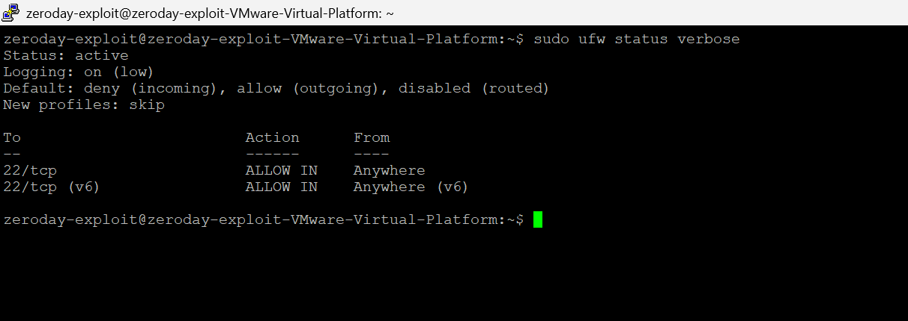
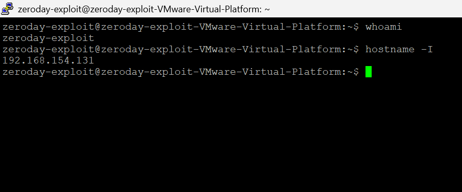
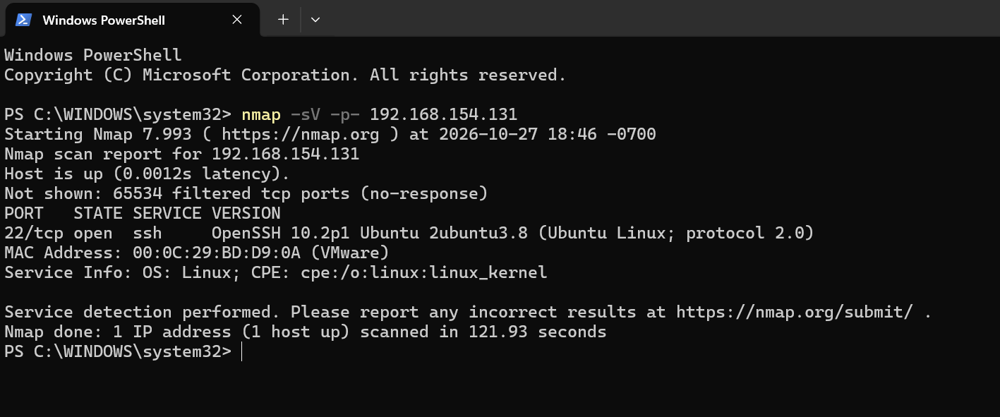

# Phase 2: Secure Remote Administration

**Project:** APEX Tech Forge Academy Cybersecurity Capstone
**Author:** Edward Jose Maria
**Date:**   27th October,2026.

## Objective

Establish an encrypted SSH tunnel from my Windows host to the Academy's Linux server (Ubuntu on VMware Workstation), restrict the server's exposure with a firewall, and verify the result with a port scan.

## Lab environment

| Component | Details |
|---|---|
| Host | Windows with PuTTY and Nmap |
| Target server | Ubuntu on VMware Workstation (NAT), IP 192.168.154.131 |
| Services | OpenSSH server, UFW firewall |

## Requirements checklist

- [x] Install and configure OpenSSH on the Linux machine
- [x] Configure UFW to allow port 22
- [x] Connect from Windows using PuTTY
- [x] Run an nmap scan against the VM's IP

## Steps performed

1. Updated the system: `sudo apt update && sudo apt upgrade -y`
2. Installed the tools: `sudo apt install -y openssh-server`, `ufw`, `net-tools`, `nmap`
3. Enabled and started SSH: `sudo systemctl enable --now ssh`, then confirmed **active (running)** with `sudo systemctl status ssh`
4. Configured the firewall, allowing SSH before enabling it:
   - `sudo ufw default deny incoming`
   - `sudo ufw default allow outgoing`
   - `sudo ufw allow 22/tcp`
   - `sudo ufw enable`
5. Verified the firewall rules: `sudo ufw status verbose`
6. Connected from Windows with PuTTY (host 192.168.154.131, port 22, SSH)
7. Scanned the server from Windows: `nmap -sV -p- 192.168.154.131`

## Evidence

### Firewall configuration

*UFW is active with a default deny policy for incoming traffic and a single rule allowing 22/tcp.*

### Encrypted SSH session

*A successful PuTTY login to the Linux server over SSH.*

### Nmap scan

*A full port scan (all 65,535 ports) shows port 22/tcp (SSH) as the only open port. All other ports are filtered, which validates the UFW configuration.*

## What I learned

- A default-deny firewall hides every service except the ones explicitly allowed, which shrinks the server's attack surface.
- SSH encrypts both credentials and session data, unlike plaintext protocols such as Telnet.
- Scanning my own server from outside confirms the firewall works as intended.
- A VPN on the host can block traffic to the VM network, so I kept it off during the lab.

## Next phase

[Phase 3: Data Integrity Verification](../phase3-data-integrity)
