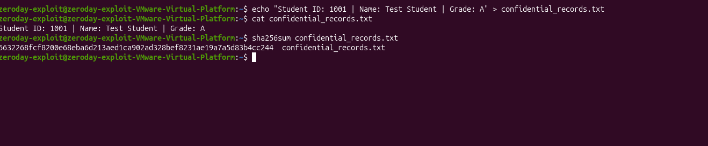
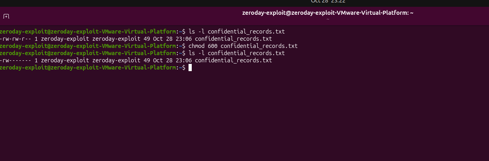
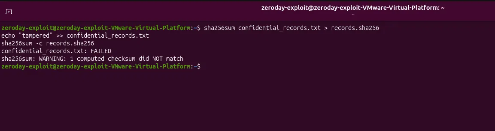

# Phase 3: Data Integrity Verification

**Project:** APEX Tech Forge Academy Cybersecurity Capstone
**Author:** Edward Jose Maria
**Date:** 28th October, 2026

## Objective

Use cryptography to prove a file's integrity, and restrict access to a sensitive records file so that only its owner can read or modify it.

## Requirements checklist

- [x] Create a text file named `confidential_records.txt` on the Linux machine
- [x] Generate a SHA-256 hash of the file
- [x] Use `chmod` to strip read/write permissions from the group and other users

## Steps performed

1. Created the file: `echo "Student ID: 1001 | Name: Test Student | Grade: A" > confidential_records.txt`
2. Displayed its contents: `cat confidential_records.txt`
3. Generated the SHA-256 hash: `sha256sum confidential_records.txt`
4. Checked the original permissions: `ls -l confidential_records.txt` (`-rw-rw-r--`, readable and writable by the group)
5. Restricted the file to its owner: `chmod 600 confidential_records.txt`
6. Verified the new permissions: `ls -l confidential_records.txt` (`-rw-------`)
7. Bonus: saved the hash to a file, deliberately modified the record, and re-checked it with `sha256sum -c`

## Evidence

### File creation and SHA-256 hash

*The records file is created and its SHA-256 hash is generated. This hash is the file's fingerprint in its original, trusted state.*

### File permissions before and after chmod

*Before: `-rw-rw-r--` lets the group read and write the file. After `chmod 600`: `-rw-------` limits access to the owner only.*

### Bonus: tamper detection

*After the file was deliberately modified, `sha256sum -c` reports FAILED because the new hash no longer matches the original. The modification was made after the first screenshot, so the file's current hash differs from the one shown there.*

## Why hashing is vital for incident response

Hashing creates a unique digital fingerprint of a file, so changing even one character produces a completely different hash. During incident response, comparing a file's current hash with a known-good hash quickly shows whether malware or an attacker has tampered with it, and which backups can still be trusted.

## What I learned

- A cryptographic hash makes tampering detectable without having to inspect the file contents manually.
- `chmod 600` applies the principle of least privilege: only the file's owner can read or modify it, which protects confidentiality.
- Hashing supports **integrity**, and file permissions support **confidentiality**. Together they apply two parts of the CIA Triad from Phase 1.

## Next phase

[Phase 4: Network Monitoring & Validation](../phase4-network-monitoring)
