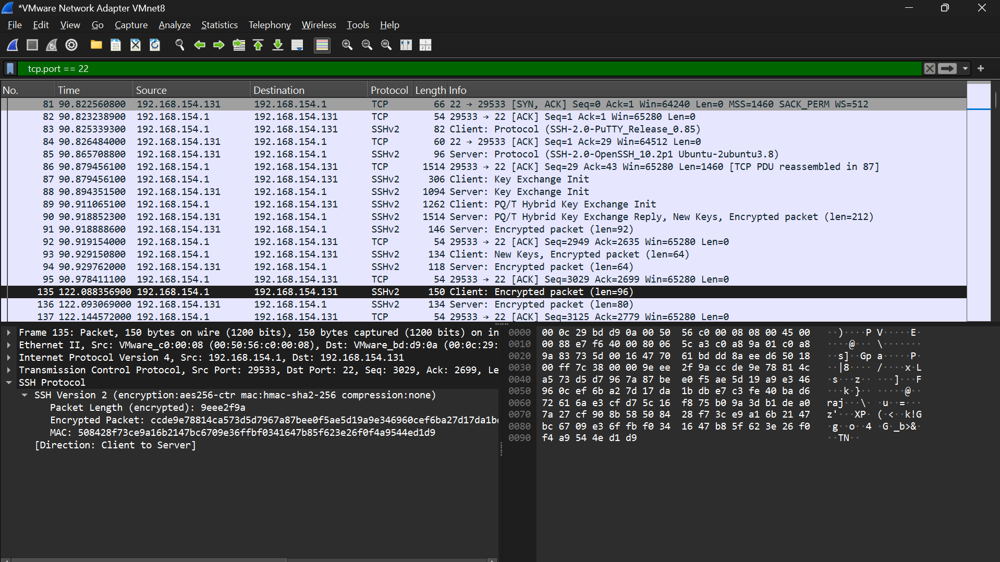
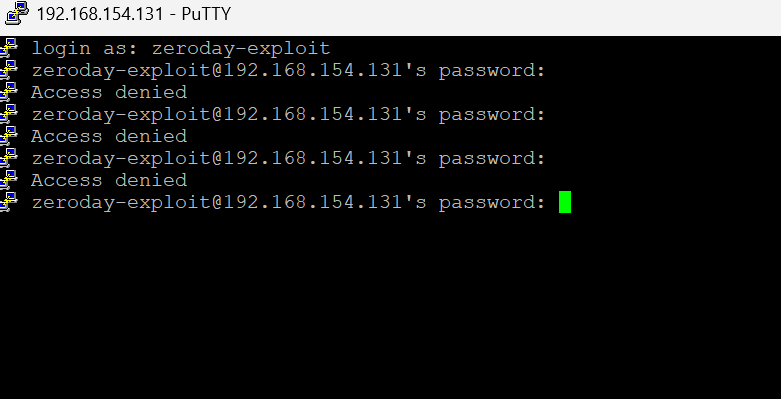
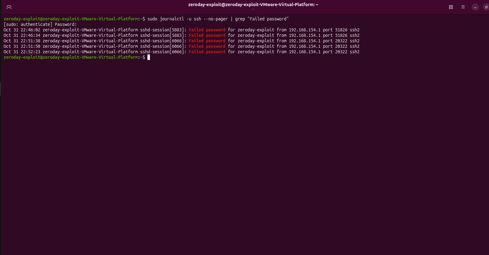

# Phase 4: Network Monitoring & Validation

**Project:** APEX Tech Forge Academy Cybersecurity Capstone
**Author:** Edward Jose Maria
**Date:** 31 October 2026

## Objective

Verify that the security controls from the earlier phases work: capture live traffic to confirm that SSH is encrypted, trigger a failed login on purpose, and locate the log entry that recorded it.

## Requirements checklist

- [x] Explain how a firewall acts as a network choke point
- [x] Capture live traffic in Wireshark while the Phase 2 SSH session is active
- [x] Intentionally fail an SSH login with a fake password
- [x] Locate the security log that recorded the failure

## The firewall as a network choke point

A firewall sits at the single point where traffic enters a system, so every connection has to pass through it and be checked against the rules. On my server, UFW denies all incoming traffic by default and allows only port 22, which means any connection to any other port is dropped before it can reach a service. Because all traffic funnels through one place, I can control, inspect and log it from one spot, and block unwanted traffic without securing every service individually.

## Steps performed

1. Started a Wireshark capture on the VMware VMnet8 adapter and applied the display filter `tcp.port == 22`.
2. Connected to the server with PuTTY (192.168.154.131, port 22) and ran a few commands to generate traffic.
3. Stopped the capture and inspected the SSH packets.
4. Opened new PuTTY sessions and entered a wrong password for `zeroday-exploit` several times, which was rejected each time.
5. On the server, searched the SSH service log: `sudo journalctl -u ssh --no-pager | grep "Failed password"`

## Evidence

### Wireshark: encrypted SSH traffic

*Capture of the active SSH session on port 22. After the handshake and key exchange, the traffic appears only as "Encrypted packet", using aes256-ctr encryption with hmac-sha2-256 integrity checking.*

**Why this is secure compared to HTTP or Telnet:** Everything after the key exchange is encrypted, so someone capturing this traffic cannot read my username, password or commands. Only the version banners are visible, and they contain no credentials. A capture of HTTP or Telnet would show usernames, passwords and every command as plain readable text, which an attacker on the network could read directly.

### Failed login attempts in PuTTY

*Three rejected login attempts using a deliberately wrong password.*

### Server log entry for the failed logins

*The SSH service log records each failed attempt, with the timestamp, the targeted username (`zeroday-exploit`), the source address (192.168.154.1) and the source port.*

**Why monitoring this log is critical for detecting brute-force attacks:** A brute-force attack shows up as many failed logins for one or more accounts in a short time, often from the same source address. Watching this log lets an analyst spot the pattern early, block the source address, and respond before the attacker guesses a valid password.

## What I learned

- Encryption protects credentials and commands from anyone capturing traffic on the network.
- A default-deny firewall reduces the attack surface to only the services I choose to expose.
- Logs turn invisible attacks into evidence: every failed login leaves a record that a SOC analyst can search, alert on and act on.
- Together, the firewall, encrypted access, file integrity checks and log monitoring support all three parts of the CIA Triad from Phase 1.

## Next step

Assemble the final PDF Incident Report in the [final-report](../final-report) folder.
